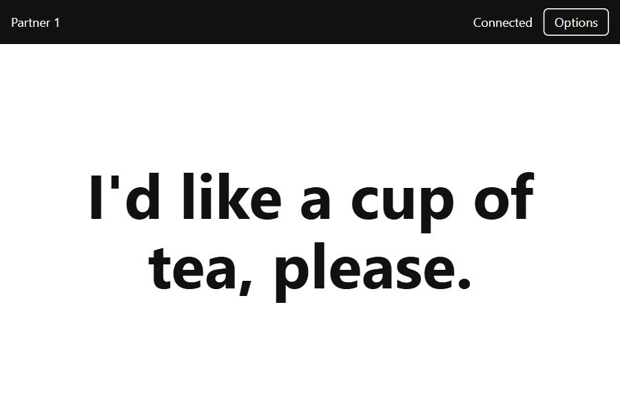

# AACpipe

**An additional partner screen for AAC users.** Send composed text from
a Windows AAC device to a partner's phone or tablet browser over a trusted
local network, without an app (uses browser) account or AACpipe cloud service.  
The AAC user sets up a channel and the user navigates to this using a QR code.

**Experimental Windows preview: `0.1.0-preview.1`.** Not a replacement for the
user's normal AAC communication. This preview is unsigned.

I have made this for a specific couple of people as an experiment.  Inspired by
Meredith Miguel's work and the uptake of partner screens.  This is intended to
prompt discussions about developing a standard for communication with AAC partner
apps/devices.  There is a very initial draft of a protocol included in 
./AACPipe Partner Screen App Protocol.md .

I've made this work with Grid3 intiially, using an ugly method - copying onto the 
clipboard.  It will be easier to implement in Mind Express via Python calls and
 TBC in Communicator.

> **Trusted networks only.** The receiver page is served over HTTP. An active
> network attacker can replace it and steal the pairing credential, despite
> subsequent message encryption. Use your own hotspot or a trusted private
> network, not public Wi-Fi. Read [Security](SECURITY.md) and
> [Privacy](docs/privacy.md).

** In other words - ASSUME THAT SOMEONE CAN READ WHAT IS SENT via AACPipe. **
This is similar to someone who might be able to hear what you say if they stood 
nearby, or outside your house, but theoretically worse if someone has hacked into
 your network then they'd be able to read this from anywhere (but then they'd 
 also be able to do a lot more/worse harm) 

## Get started

1. Obtain the Windows installer and `SHA256SUMS.txt` from the maintainer's
   [Releases page](https://github.com/simonjudge/AACpipe/releases), **when a
   preview is published**. No public release is implied by this README.
   Developers can [build locally](docs/development.md).
2. Check its hash with
   `Get-FileHash ".\AACpipe Setup 0.1.0-preview.1.exe" -Algorithm SHA256`.
   A checksum detects corruption; it is not a substitute for code signing.
   Install only a build whose source you trust. Do not disable Windows security.
3. Run AACpipe from the shortcut. It stays in the Windows tray when its pairing
   window is closed. Use the tray menu to reopen it or quit.
4. Connect the partner device to the **same trusted Wi-Fi network** or the AAC
   device's **Windows mobile hotspot**. If Windows Firewall prompts, permit
   access only on your trusted Private network.
5. Scan **Recommended: stable .local address** with the partner device. If it
   will not connect, expand **IP-address fallbacks** and scan the address for
   the shared Wi-Fi/hotspot adapter. QR codes and Copy link contain secrets:
   share them only with that partner.

   ### Implementing in Grid3
6. Follow the [Grid 3 cell-action setup](docs/grid3-test-cell-actions.md).
   Configure Grid to run:
   `%LOCALAPPDATA%\Programs\AACpipe\aacpipe-bridge.exe` with the relevant --switch from the list above.
   Start AACpipe and wait for the pairing window before the first Grid session.

   I have made, using Will's fab Tools, a way of adding these commands automatically to a gridset
    (as Grid3, is made in such a way (ahem) that these commands could be in many many places).  
    https://griset-cell-changer-temp.netlify.app/gridset-cell-changer 
    ->  and then apply these 3 schemas: [docs/gridset-change-schemas] 
   -> a simple demo gridset (one page of text talker) is also included: [docs/AACPipe Demo.gridset](docs/AACPipe%20Demo.gridset)
    

## Pairings and controls

### Optional OCR integration

An experimental [standalone OCR companion](docs/ocr.md) can read a fixed-layout
AAC message bar without clipboard access. It finds the AAC window (such as
Grid 3) and its chat area automatically (graphic symbols are ignored); confirm
or adjust the area, calibrate the empty message, and share stable text changes
through
the existing bridge. It runs separately from AACpipe and must not run alongside
other content-producing Grid/direct integrations. See the guide for build,
setup, privacy and capture limitations.

- Use **New permanent pairing** for a known partner: give it a distinct name.
  Its browser remembers the pairing through reloads/restarts.
- Use **New one-time pairing** for a temporary partner. It ends on disconnect,
  reload, Revoke or Publisher exit and is not saved.
- **Revoke**, next to a partner's name, confirms before invalidating it.
  Commands also revoke by label, including one-time labels:
  `aacpipe-bridge.exe --revoke --label "One-time 1"`.
- `--show` / `--hide` (also `-show` / `-hide`) work alone or with commands.
  Sentence, word, speak and clear commands hide the window by default so it
  does not cover Grid. Add `--show` to override.
- The receiver's **Options** enables optional TTS on speak, an attention beep,
  or keeping the screen awake. All start off. Tap the enable banner after a
  reload; audio, background operation and wake behavior depend on the browser.
  **Forget** removes this browser's pairing; use Publisher Revoke to invalidate it.

## Connection help

No internet or existing Wi-Fi router is necessary when using a Windows hotspot,
but **a shared network is necessary**. Bluetooth, Wi-Fi Direct and dedicated
hardware receivers are not implemented.

The saved `.local` hostname is designed to survive IP changes. Some VPNs,
guest networks and firewalls block mDNS or device-to-device access; use an IP
fallback on the correct shared network instead. Do not open router ports.
IP links may need rescanning after an address change. Browser storage belongs
to each address: switching between `.local` and IP requires pairing again.

Use **Refresh network information** to update adapter links; restart AACpipe to
retry failed discovery. A disconnected receiver clears its text when connection
loss is detected; silent loss is subject to a timeout.

The pairing UI is intentionally available **only in the AACpipe window**.
Opening `/manage` in another browser is forbidden.

## Upgrading, feedback and licence

Upgrades **from this preview onward** preserve pairings. The older `0.1.0`
test installer has a destructive uninstaller: upgrading from it may reset
pairings. Expect to pair again. A normal uninstall removes Windows app data;
use Forget to remove browser credentials too.

For a bug, include versions, network type and **Copy diagnostics** from the
pairing window. Never post real messages, QR codes or pairing URLs.
For vulnerabilities follow [private reporting](SECURITY.md), not public issues.

AACpipe source and original artwork are [MIT licensed](LICENSE): attribution
required, commercial use allowed, no warranty. Builds include third-party
notices and Electron/Chromium licence files.

- [Preview release notes](docs/releases/0.1.0-preview.1.md)
- [Acceptance checks](docs/acceptance-tests.md)
- [Release checklist](docs/release-checklist.md)
- [Development](docs/development.md) and [contributing](CONTRIBUTING.md)
- [Protocol](AACPipe%20Partner%20Screen%20App%20Protocol.md)
